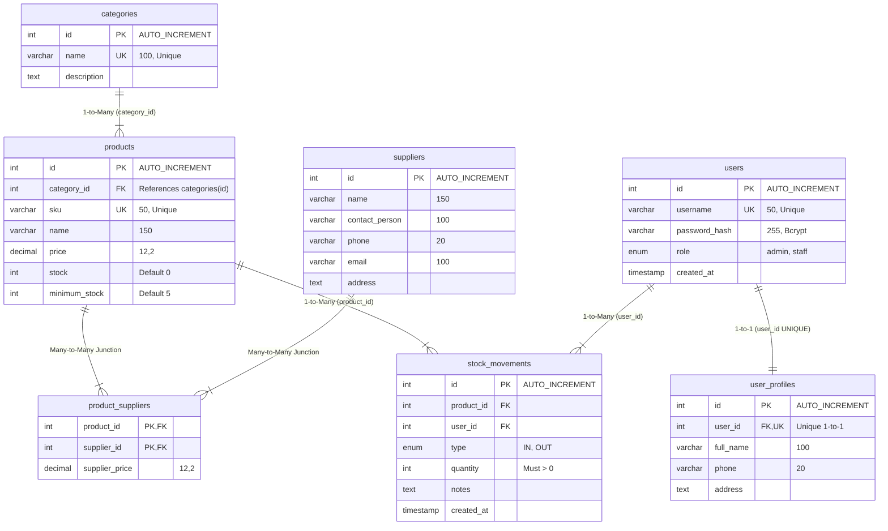

[README.md](https://github.com/user-attachments/files/33473626/README.md)
# 📦 Inventory Management System (Mini Project 3)

[](https://www.php.net/)
[](https://www.mysql.com/)
[]()
[](https://getbootstrap.com/)
[]()

> **Tugas Pertemuan 4: Relational Database + Advanced PHP**  
> *"Dari CRUD menuju aplikasi berbasis relasi, transaksi, laporan, dan business logic"*

Aplikasi **Inventory Management System** komprehensif yang dirancang untuk mengelola stok persediaan barang secara terintegrasi dengan penegakan relasi database relasional, transaksi atomik ACID (Commit/Rollback), validasi ganda (sintaktis & semantik), otorisasi berbasis peran (Admin & Staff), dan laporan analitik menggunakan fungsi agregat SQL.

---

## 📑 Daftar Isi
- [Preview Tangkapan Layar](#-preview-tangkapan-layar)
- [Fitur Utama & Rubrik Penilaian](#-fitur-utama--rubrik-penilaian)
- [Desain Database & Entity Relationship Diagram (ERD)](#-desain-database--entity-relationship-diagram-erd)
- [Penegakan Aturan Bisnis (Business Rules)](#-penegakan-aturan-bisnis-business-rules)
- [Implementasi Keamanan (Security)](#-implementasi-keamanan-security)
- [Struktur Direktori Proyek](#-struktur-direktori-proyek)
- [Panduan Instalasi & Penggunaan](#-panduan-instalasi--penggunaan)
- [Akun Demo Pengujian](#-akun-demo-pengujian)
- [Pengujian Otomatis (Automated Testing)](#-pengujian-otomatis-automated-testing)

---

## 📸 Preview Tangkapan Layar

| Dashboard Utama & 5 Widget Agregat | Katalog Produk (Search, Filter & Sorting) |
| :---: | :---: |
|  |  |

| Laporan Rekapitulasi & Valuasi (Slide 28) | Otorisasi Server-Side (403 Forbidden - Slide 24) |
| :---: | :---: |
|  |  |

| Transaksi Barang Masuk (Atomic ACID) | Validasi Error: Barang Keluar > Sisa Stok |
| :---: | :---: |
|  |  |

---

## 🎯 Fitur Utama & Rubrik Penilaian

Aplikasi ini memenuhi 100% kriteria penilaian pada **Slide 32 (Fitur Wajib)** dan **Slide 35 (Rubrik Penilaian)**:

| Komponen Penilaian | Bobot | Fitur yang Diimplementasikan |
| :--- | :---: | :--- |
| **Desain Database & Relasi** | **20%** | Memenuhi 3 macam relasi: **One-to-One** (`users ↔ user_profiles`), **One-to-Many** (`categories → products`, `products → stock_movements`), dan **Many-to-Many** (`products ↔ suppliers` via junction table). |
| **Foreign Key & Integritas Data** | **10%** | Penerapan batasan `ON DELETE CASCADE` (profil) dan `ON DELETE RESTRICT` (kategori, produk berhistori, dan supplier). Mencegah orphan record. |
| **CRUD Master Data** | **10%** | CRUD lengkap untuk Produk, Kategori, Supplier, dan Relasi Produk-Supplier. |
| **Transaksi Masuk/Keluar** | **20%** | Transaksi atomik database (`beginTransaction`, `commit`, `rollBack`) dengan penguncian baris `SELECT ... FOR UPDATE` untuk mencegah race condition. |
| **Search, Filter, Sorting, Pagination** | **10%** | Pencarian multi-kolom (Nama / SKU), filter kategori & status stok kritis, sorting berbasis allowlist (mencegah SQLi), dan navigasi paginasi dinamis. |
| **Login, Session, Authorization** | **10%** | Session guard, `session_regenerate_id(true)`, role separation (**Admin** vs **Staff**), dan proteksi server-side HTTP 403. |
| **Keamanan Aplikasi** | **15%** | PDO Prepared Statements di seluruh query, sanitasi output XSS `htmlspecialchars()`, validasi server-side ganda, CSRF Token protection, dan hashing sandi `PASSWORD_BCRYPT`. |
| **Kerapian & Presentasi** | **5%** | Desain antarmuka modern Bootstrap 5, responsif, notifikasi flash interaktif, dan dokumentasi lengkap siap publikasi GitHub. |

---

## 🗄 Desain Database & Entity Relationship Diagram (ERD)

Database terdiri dari 7 tabel yang saling terhubung secara terstruktur:



*Dokumentasi detail mengenai skema dan matriks relasi dapat dibaca di [docs/ERD.md](docs/ERD.md).*

---

## ⚖ Penegakan Aturan Bisnis (Business Rules)

Sesuai **Slide 33**, seluruh aturan bisnis diterapkan secara ketat baik di level kode program maupun basis data:

1. **SKU Harus Unik**: Kolom `sku` bersifat `UNIQUE` dan divalidasi semantik di server (`validate_sku()`).
2. **Harga dan Quantity Tidak Boleh Negatif**: Validasi `price >= 0` dan `quantity >= 1`.
3. **Barang Keluar Tidak Boleh Melebihi Stok**: Menggunakan rumus:
   $$\text{stok akhir} = \text{stok awal} + \text{total barang masuk} - \text{total barang keluar}$$
   Jika kuantitas keluar $> \text{stok fisik}$, transaksi langsung dibatalkan (*Rollback*) dan stok tidak menjadi negatif.
4. **Produk yang Memiliki Histori Dilarang Dihapus**: Foreign key `ON DELETE RESTRICT` pada `stock_movements` melindungi catatan riwayat transaksi audit.
5. **Halaman Internal Wajib Login**: Pengunjung anonim diarahkan kembali ke form login (`require_login()`).
6. **Staff Dilarang Mengakses Administrasi User**: Server menegakkan `require_role('admin')` dan merespon kode **HTTP 403 Forbidden**.
7. **Sorting Allowlist**: Kolom pengurutan divalidasi terhadap daftar putih (`['name', 'sku', 'price', 'stock']`) untuk mencegah injeksi SQL pada klausul `ORDER BY`.

*Dokumentasi detail implementasi dapat dibaca di [docs/BUSINESS_RULES.md](docs/BUSINESS_RULES.md).*

---

## 🔒 Implementasi Keamanan (Security)

1. **PDO Prepared Statements (Slide 18 & 19)**: Pemisahan utuh struktur query SQL dari nilai input user. Tidak ada perangkaian (*string concatenation*) data mentah ke dalam string query SQL.
2. **Pencegahan XSS / Output Escaping (Slide 20)**: Seluruh data dinamis yang dirender ke tampilan HTML disaring melalui fungsi `e()` menggunakan `htmlspecialchars($str, ENT_QUOTES, 'UTF-8')`.
3. **Validasi Sintaktis & Semantik (Slide 21)**: Pengecekan tipe data, panjang string, serta keberadaan kunci relasi di database sebelum pemrosesan.
4. **Password Hashing dengan Bcrypt (Slide 23)**: Penyimpanan sandi menggunakan fungsi `password_hash($pass, PASSWORD_BCRYPT)` dan diverifikasi dengan `password_verify()`.
5. **Session Fixation Countermeasure (Slide 22 & 23)**: Pemanggilan `session_regenerate_id(true)` saat proses autentikasi berhasil.
6. **Proteksi CSRF (Cross-Site Request Forgery)**: Formulir POST dilindungi dengan token CSRF unik yang divalidasi per sesi.

---

## 📁 Struktur Direktori Proyek

Struktur folder terstruktur rapi mengikuti rekomendasi **Slide 34**:

```text
miniproject3/
├── .gitignore                   # Konfigurasi Git ignore
├── README.md                    # Dokumentasi utama proyek
├── index.php                    # Entry point pengarah utama
├── config/
│   └── database.php             # Konfigurasi koneksi PDO & error handling
├── database/
│   ├── schema.sql               # Definisi tabel, relasi, dan FK constraints
│   └── seed.sql                 # Data awal akun, master data, dan histori transaksi
├── docs/
│   ├── ERD.md                   # Dokumentasi diagram entitas & relasi
│   ├── BUSINESS_RULES.md        # Rincian aturan bisnis pergudangan
│   └── TESTING.md               # Skenario pengujian dan evaluasi
├── helpers/
│   ├── auth.php                 # Helper autentikasi, sesi, & otorisasi role
│   ├── escape.php               # Helper escaping XSS & format mata uang Rupiah
│   ├── flash.php                # Helper notifikasi flash message Bootstrap
│   └── validation.php           # Helper validasi data, allowlist sort, & CSRF
├── public/                      # Web root publik
│   ├── 403.php                  # Halaman error 403 Forbidden
│   ├── index.php                # Gerbang routing publik
│   ├── login.php                # Form autentikasi pengguna
│   ├── logout.php               # Pembersihan sesi login
│   ├── dashboard.php            # Dashboard metrik & laporan agregat
│   ├── profile.php              # Profil akun & ganti sandi
│   ├── categories/              # Modul master kategori
│   ├── products/                # Modul master produk (Search, Filter, Sort, Pagination)
│   ├── suppliers/               # Modul master supplier
│   ├── product-suppliers/       # Modul relasi many-to-many produk & supplier
│   ├── stock/                   # Modul transaksi atomik (Barang Masuk, Keluar, Histori)
│   ├── reports/                 # Modul laporan agregasi (Slide 28)
│   └── users/                   # Modul manajemen pengguna (Khusus Role Admin)
├── screenshots/                 # Tangkapan layar antarmuka aplikasi
├── tests/
│   └── test_runner.php          # Skrip pengujian otomatis (CLI Test Suite)
└── views/
    ├── header.php               # Header HTML & aset Bootstrap 5
    ├── navbar.php               # Menu navigasi berbasis role
    └── footer.php               # Penutup halaman & copyright
```

---

## 🚀 Panduan Instalasi & Penggunaan

### Persyaratan Sistem
- PHP versi 8.0 atau lebih baru (ekstensi `pdo_mysql` aktif).
- MySQL 5.7+ atau MariaDB 10.4+.
- Web Server (Apache XAMPP / Laragon / Built-in PHP Server).

### Langkah 1: Clone atau Buka Folder Proyek
```bash
git clone https://github.com/username/miniproject3.git
cd miniproject3
```

### Langkah 2: Impor Skema & Data Database
1. Buka MySQL CLI, phpMyAdmin, atau MySQL Workbench.
2. Buat database dan jalankan file SQL yang disediakan:
```bash
# Impor skema tabel
mysql -u root -p < database/schema.sql

# Impor data awal (seed)
mysql -u root -p < database/seed.sql
```
*(Secara default konfigurasi menghubungkan ke `localhost:3306`, nama database `inventory_db`, user `root`, tanpa password. Jika ada perbedaan, sesuaikan pada file `config/database.php`).*

### Langkah 3: Jalankan Web Server
Anda dapat menjalankannya dengan mudah menggunakan server bawaan PHP:
```bash
php -S localhost:8080 -t .
```
Lalu buka peramban (*browser*) Anda pada tautan:
**`http://localhost:8080/public/login.php`** (atau `http://localhost/miniproject3/` jika menggunakan Apache XAMPP).

---

## 🔑 Akun Demo Pengujian

Aplikasi telah disiapkan dengan dua peran akun untuk menguji otorisasi (*Role-Based Access Control*):

| Role | Username | Password | Hak Akses Utama |
| :---: | :---: | :---: | :--- |
| **Admin** | `admin` | `password123` | Akses penuh: Kelola Pengguna, Kategori, Produk, Supplier, Relasi Produk-Supplier, Mutasi Stok, dan Laporan. |
| **Staff** | `staff` | `password123` | Akses operasional: Melihat Katalog Produk, Mencatat Barang Masuk, Mencatat Barang Keluar, Melihat Histori, dan Dashboard. *(Dilarang mengakses menu pengguna).* |

---

## 🧪 Pengujian Otomatis (Automated Testing)

Untuk memverifikasi keabsahan sistem, integritas foreign key, rumus konsistensi stok, dan penolakan akses terlarang 403, jalankan perintah berikut:

```bash
php tests/test_runner.php
```

Semua 13 asersi pengujian akan dievaluasi dan memberikan laporan status hijau (*PASS*).

---

## 👨‍💻 Pengembang
- **Materi**: Pertemuan 4 — Relational Database + Advanced PHP
- **Tugas**: Mini Project 3 — Inventory Management System
- **Lisensi**: MIT License
