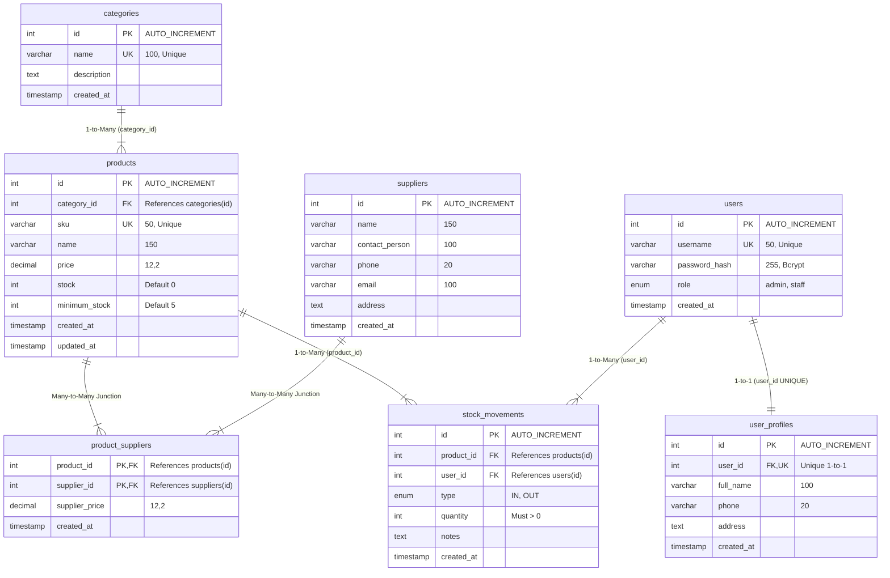

# Entity-Relationship Diagram (ERD) & Desain Database

**Mini Project 3 — Inventory Management System**  
Mata Kuliah / Materi: *Pertemuan 4: Relational Database + Advanced PHP*

---

## 1. Diagram Relasi Entitas (Mermaid ERD)

---

## 2. Penjelasan Jenis Relasi Sesuai Slide Materi

### A. One-to-One (`users` &harr; `user_profiles`) — Slide 5 & 6
- **Konsep**: Satu akun user memiliki tepat satu data profil lengkap.
- **Implementasi**: Kolom `user_id` pada tabel `user_profiles` diberi batasan **`UNIQUE`** dan Foreign Key yang mengarah ke `users(id)`.
- **Aksi Referensial**: `ON DELETE CASCADE ON UPDATE CASCADE`. Jika akun user dihapus, profil terkait akan otomatis terhapus tanpa meninggalkan data yatim (*orphan records*).

### B. One-to-Many (`categories` &rarr; `products`) — Slide 5 & 7
- **Konsep**: Satu kategori barang dapat menaungi banyak produk, namun satu produk hanya dimiliki oleh satu kategori.
- **Implementasi**: Foreign key `category_id` diletakkan pada tabel anak (`products`).
- **Aksi Referensial**: `ON DELETE RESTRICT ON UPDATE CASCADE`. Kategori tidak boleh dihapus selama masih terdapat produk di dalamnya, mencegah produk kehilangan klasifikasi.

### C. Many-to-Many (`products` &harr; `suppliers`) — Slide 5 & 8
- **Konsep**: Satu produk dapat dipasok oleh banyak supplier yang berbeda dengan kesepakatan harga beli masing-masing, dan satu supplier dapat menyuplai banyak jenis produk.
- **Implementasi**: Menggunakan tabel perantara (*junction table*) bernama `product_suppliers`.
- **Composite Primary Key**: `PRIMARY KEY (product_id, supplier_id)`. Mencegah terjadinya duplikasi pasangan produk-supplier yang sama.
- **Kolom Tambahan**: `supplier_price` (harga pasokan/beli khusus dari supplier tersebut).

### D. One-to-Many Transaksi (`products` &rarr; `stock_movements` & `users` &rarr; `stock_movements`) — Slide 10
- **Konsep**: Setiap transaksi mutasi barang (masuk/keluar) dicatat dalam tabel `stock_movements`.
- **Relasi**:
  1. `stock_movements.product_id` mereferensikan `products.id`.
  2. `stock_movements.user_id` mereferensikan `users.id` (siapa staf/admin yang mencatat mutasi).
- **Aksi Referensial**: `ON DELETE RESTRICT`. Produk atau user yang sudah memiliki riwayat mutasi **TIDAK BOLEH** dihapus sembarangan agar *audit trail* logistik dan keuangan tetap utuh.

---

## 3. Referential Integrity Matrix

| Tabel Asal | Kolom FK | Tabel Referensi | On Delete | On Update | Tujuan Bisnis |
| :--- | :--- | :--- | :--- | :--- | :--- |
| `user_profiles` | `user_id` | `users(id)` | **CASCADE** | **CASCADE** | Profil otomatis terhapus jika akun user dihapus |
| `products` | `category_id` | `categories(id)` | **RESTRICT** | **CASCADE** | Mencegah kategori dihapus jika masih ada produk |
| `product_suppliers` | `product_id` | `products(id)` | **CASCADE** | **CASCADE** | Menghapus pemetaan jika master produk dihapus |
| `product_suppliers` | `supplier_id` | `suppliers(id)` | **RESTRICT** | **CASCADE** | Mencegah supplier dihapus jika masih aktif menyuplai barang |
| `stock_movements` | `product_id` | `products(id)` | **RESTRICT** | **CASCADE** | Melindungi riwayat mutasi fisik barang |
| `stock_movements` | `user_id` | `users(id)` | **RESTRICT** | **CASCADE** | Melindungi pertanggungjawaban petugas operasional |
